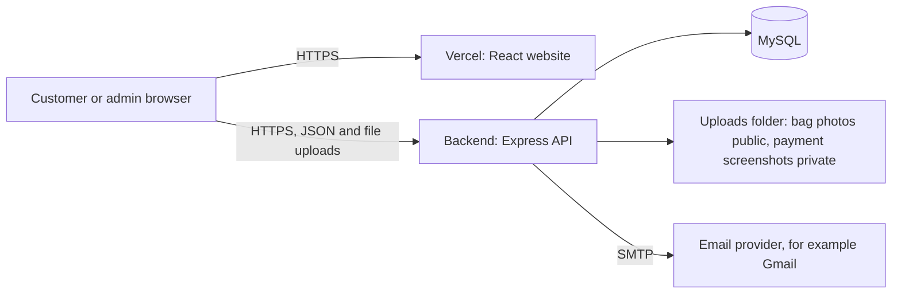
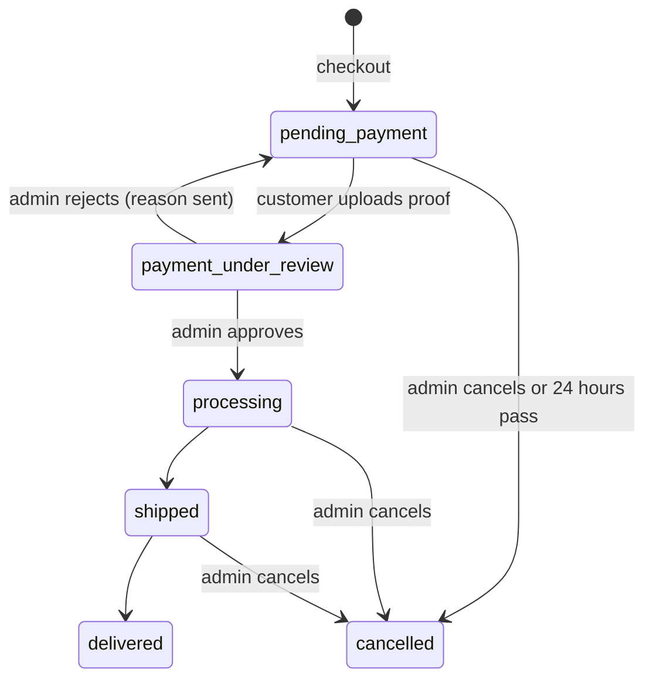

# Technical Requirements Document (TRD)

**Product:** Bryans Arabella Collection
**Version:** 1.0, October 2026

## 1. Stack
| Layer | Technology |
|---|---|
| Website | React 18, Vite 6, TypeScript 5, Tailwind CSS 4 |
| State | Zustand (auth, cart, theme, wishlist, unread count) with local storage where needed |
| Data fetching | Axios with a bearer-token interceptor |
| Routing | React Router 7 |
| Backend | Node.js 22, Express 5 |
| Database | MySQL (tested on MariaDB 10.11), `mysql2` driver |
| Passwords | `bcryptjs` |
| Uploads | `multer` writing to the server's disk |
| Email | `nodemailer` 10 over SMTP |
| Safety | `helmet`, `express-rate-limit` |
| Hosting | Website on Vercel; backend on a VPS or always-on host (not yet live) |
| Source | GitHub repository `zeddx8/Bryans-Arabella` |

The original specification asked for Laravel Sanctum. The owner chose Node and Express, with the same endpoints and a Sanctum-style token design.

## 2. Architecture

- The website is static files. It calls the API at the address baked in as `VITE_API_URL` when it is built.
- The backend must be reachable over **https**, because browsers block an https site from calling plain `http`.
- The backend allows requests only from the website address(es) in `CLIENT_URL` (CORS).

## 3. Repository layout
```
bryans-arabella/
├── backend/
│   ├── schema.sql              all tables
│   ├── check-database.js       compares your database with the app and repairs it
│   ├── src/
│   │   ├── server.js           app setup, security, routes, errors
│   │   ├── setup.js            creates or upgrades the database, first admin, categories
│   │   ├── db.js  utils.js  mailer.js  jobs.js
│   │   ├── middleware/         auth.js, upload.js, limits.js
│   │   └── routes/             auth, products, account, orders, admin
│   └── uploads/                products/ (public)  payments/ (private)
├── frontend/
│   ├── public/vercel.json      makes page refreshes work on Vercel
│   └── src/                    components, pages, services, store, types, routes
├── docs/                       these documents
├── DEPLOY.md  PHASES.md  README.md
```

## 4. Data model
Tables from the specification: `users`, `addresses`, `categories`, `products`, `product_images`, `reviews`, `orders`, `order_items`, `payments`.

Added by the build:
| Table or column | Purpose |
|---|---|
| `personal_access_tokens` | Sign-in tokens. Only a SHA-256 hash is stored; tokens expire after 30 days |
| `auth_tokens` | One-time links for email confirmation (3 days) and password reset (1 hour), stored as hashes |
| `users.email_verified_at` | When the email was confirmed |
| `products.sku`, `products.cost_price`, `products.deleted_at` | SKU, cost, and soft delete |
| `reviews.title` | Review title |
| `order_items.product_name` | Name kept at the time of purchase |
| `wishlists` | One row per saved bag per customer |
| `messages` | Inbox: system and admin messages, and customer messages |

Key rules enforced in the data layer:
- Money is `DECIMAL(10,2)`; amounts are rounded to 2 places in code.
- Foreign keys cascade or set null as in the specification.
- Bags are never hard deleted; `deleted_at` hides them.

## 5. Order and payment states

Payment rows have their own status: `pending`, `verified`, `rejected`. Only the latest payment of an order counts.

**Stock:** reduced inside the checkout transaction after locking the product rows (`SELECT ... FOR UPDATE`), so two buyers cannot take the last bag. Restored on cancel or expiry.

**Expiry:** a job runs every 15 minutes and cancels orders left in `pending_payment` longer than `ORDER_HOLD_HOURS` (default 24), restocks them, and notifies the customer.

## 6. API
Base path `/api/v1`. "Auth" means a valid bearer token. "Admin" means an admin account.

**System**
| Method | Path | Access | Purpose |
|---|---|---|---|
| GET | `/health` | Public | Is the server up |

**Accounts**
| Method | Path | Access | Purpose |
|---|---|---|---|
| POST | `/auth/register` | Public (rate limited) | Create a customer, send confirmation email |
| POST | `/auth/login` | Public (rate limited) | Issue a token |
| POST | `/auth/logout` | Auth | Revoke the current token |
| GET | `/auth/me` | Auth | Current user and verified status |
| POST | `/auth/verify-email` | Public | Use a confirmation link |
| POST | `/auth/resend-verification` | Auth (limited) | New confirmation link |
| POST | `/auth/forgot-password` | Public (limited) | Send reset link; same answer for every email |
| POST | `/auth/reset-password` | Public | Set a new password; signs out all devices |

**Catalogue**
| Method | Path | Access | Purpose |
|---|---|---|---|
| GET | `/products` | Public | Search, filter, sort, paginate |
| GET | `/products/:slug` | Public | One bag, its photos, and suggested bags |
| GET | `/products/:id/reviews` | Public | Reviews |
| POST | `/products/:id/reviews` | Auth (limited) | Add a review (one per customer per bag) |

**Customer**
| Method | Path | Access | Purpose |
|---|---|---|---|
| GET, PATCH | `/account/profile` | Auth | Profile and addresses; update name and phone |
| POST | `/account/addresses` | Auth | Add or update an address |
| DELETE | `/account/addresses/:id` | Auth | Remove an address |
| GET | `/account/wishlist` | Auth | Saved bags |
| POST, DELETE | `/account/wishlist/:productId` | Auth | Save or remove a bag |
| GET | `/account/inbox` | Auth | Messages and unread count |
| PATCH | `/account/inbox/:id/read` | Auth | Mark read |
| POST | `/account/inbox` | Auth (limited) | Message the shop |
| GET | `/orders/payment-methods` | Public | Merchant numbers, account names, shipping fee |
| POST | `/orders/checkout` | Auth (limited) | Create the order and take stock |
| POST | `/orders/:id/submitpayment` | Auth | Upload payment screenshot (multipart) |
| GET | `/orders/my-orders` | Auth | Order history |

**Admin**
| Method | Path | Purpose |
|---|---|---|
| GET | `/admin/stats` | Overview numbers |
| GET | `/admin/categories` | Category list |
| GET, POST | `/admin/products` | List and create (multipart photos) |
| GET, PUT, PATCH, DELETE | `/admin/products/:id` | Read, edit, archive |
| GET | `/admin/orders` | All orders; "needs review" first |
| GET | `/admin/payments/:id/screenshot` | Private payment image |
| PATCH | `/admin/payments/:id/verify` | `approve` or `reject` with reason |
| PATCH | `/admin/orders/:id/status` | processing, shipped, delivered, cancelled |
| GET | `/admin/customers`, `/admin/customers/:id` | Customers and addresses |
| GET | `/admin/inquiries` | Customer messages |
| POST | `/admin/inquiries/:userId/reply` | Reply (inbox plus email) |

**Errors** return JSON `{ "message": "..." }` with a sensible status code (400, 401, 403, 404, 409, 422, 429, 500). While developing, a database error also shows the real cause; in production it shows a plain message.

## 7. Website design of the code
- `services/` holds every API call; pages never call Axios directly.
- `store/` holds shared state. The cart and theme persist in the browser; the token and user persist as well.
- `routes/ProtectedRoute` sends signed-out visitors to sign in and back; `AdminRoute` keeps customers out of admin screens. The server enforces the real rules.
- Pages load their own data and show loading, empty and error states.
- The `Layout` component refreshes the signed-in user on load, loads the wishlist, and refreshes the unread count on each page change.

## 8. Configuration
**Backend `.env`**
| Variable | Meaning |
|---|---|
| `PORT` | Port the API listens on (default 4000) |
| `PUBLIC_URL` | Public address of the backend; used to build photo links |
| `CLIENT_URL` | Website address(es), comma separated; allowed origin and base for email links |
| `DB_HOST`, `DB_PORT`, `DB_USER`, `DB_PASSWORD`, `DB_NAME` | Database connection |
| `ADMIN_NAME`, `ADMIN_EMAIL`, `ADMIN_PASSWORD` | First admin, created by `db:setup` |
| `SHIPPING_FEE` | Flat delivery fee in GHS |
| `ORDER_HOLD_HOURS` | Hours before unpaid orders expire (0 turns it off) |
| `MTN_NUMBER`, `MTN_ACCOUNT_NAME`, `TELECEL_*`, `AIRTELTIGO_*` | Where customers send money |
| `SMTP_HOST`, `SMTP_PORT`, `SMTP_USER`, `SMTP_PASS`, `MAIL_FROM` | Email; if empty, emails print in the terminal |
| `REQUIRE_EMAIL_VERIFICATION` | `true` blocks checkout until the email is confirmed |

**Website `.env`** (read when building): `VITE_API_URL`, the backend address with no trailing slash.

## 9. Security
| Area | Measure |
|---|---|
| Passwords | bcrypt, minimum 8 characters |
| Sessions | Random 40-byte tokens, only a hash stored, 30-day expiry, revoked on logout and on password reset |
| Admin | Role checked on the server for every admin route |
| Data access | Customers can only read and change their own orders, addresses, wishlist and inbox |
| SQL | Parameterised queries everywhere; sort options come from a fixed list |
| Money | Prices read from the database at checkout; stock locked in a transaction |
| Uploads | Only JPG, PNG, WEBP; first bytes checked; stored name and extension chosen by the server; 6 MB limit; payment screenshots served only to admins |
| Email links | One-time, expire, hashed in the database; reset answer does not reveal whether an email has an account |
| Abuse | Rate limits on sign-in, sign-up, reset requests, resend, reviews, messages, checkout |
| Headers | `helmet` defaults; CORS limited to `CLIENT_URL` |
| Output | React escapes text; descriptions are shown as text, never as HTML |
| Dependencies | `npm audit` shows zero known issues at the time of writing |

**Known gaps** (also listed in the plan): the token is kept in browser storage, so any future script-injection bug would expose it; no admin two-step login; no audit log of admin actions; no automatic account lockout beyond rate limits; the website itself is served without a custom Content-Security-Policy header; payment fraud risk is a business process matter (see PRD section 10).

## 10. Performance and capacity
- A single server and a single database are enough for a small shop.
- Product lists are paginated and photos are lazy loaded. Photos are stored as uploaded, with no resizing, so ask the owner to upload reasonably sized photos or add image resizing later.
- Because uploads sit on the server's disk, the backend cannot simply run on several servers or on Vercel without moving uploads to cloud storage (plan task 7.7).
- The expiry job and the rate limiter work inside one server process.

## 11. Deployment
See `DEPLOY.md`. In short: the backend runs under `pm2` behind `nginx` with HTTPS from Let's Encrypt; the website is built by Vercel from the `frontend` folder with `VITE_API_URL` set; `vercel.json` makes page refreshes work.

## 12. Backup and recovery
- Daily `mysqldump` and a compressed copy of `backend/uploads`, copied off the server.
- Restore: import the dump into a new database, extract `uploads`, run `npm run db:setup` to confirm structure, then `pm2 restart`.
- Test a restore once before launch.

## 13. Monitoring (recommended)
- `pm2 logs arabella-api` for errors.
- An uptime check on `/api/v1/health` from a free monitoring service.
- A monthly `npm audit` in both folders.

## 14. Quality status
Type checking and production build pass. End-to-end checks pass on the test database (see `03-development-plan.md`, section 5). Not yet covered: automatic test suite, real MySQL, real phones, and load.
