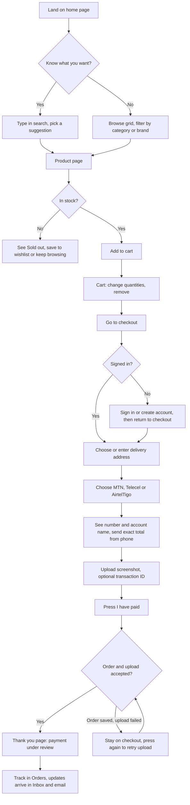
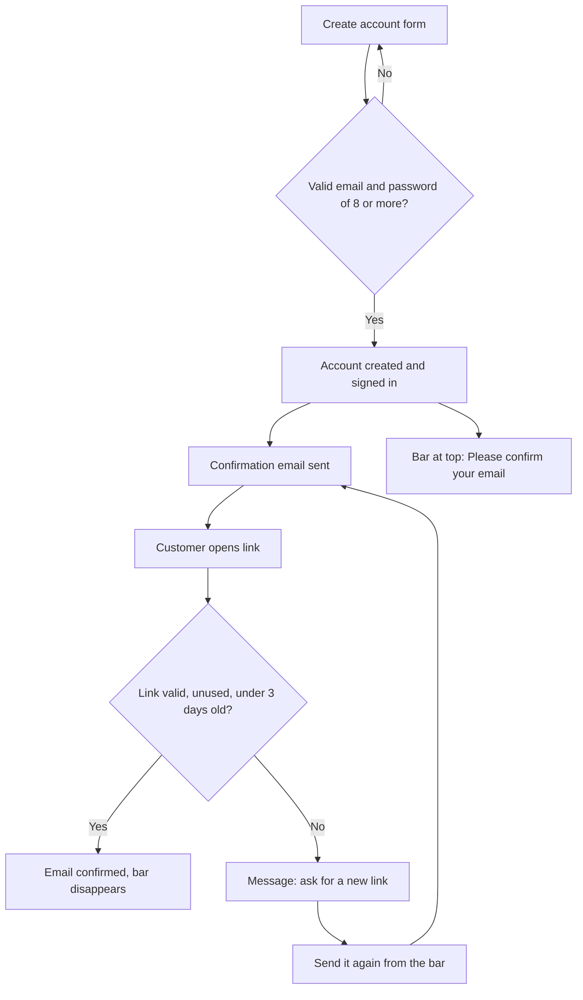
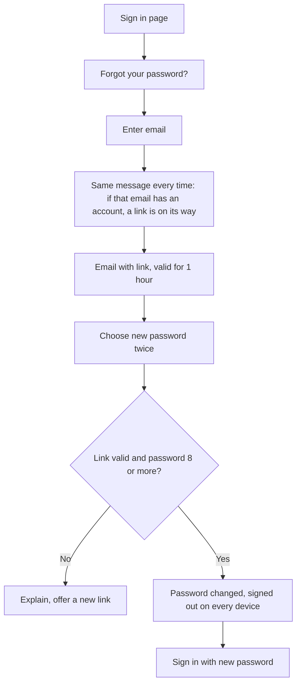
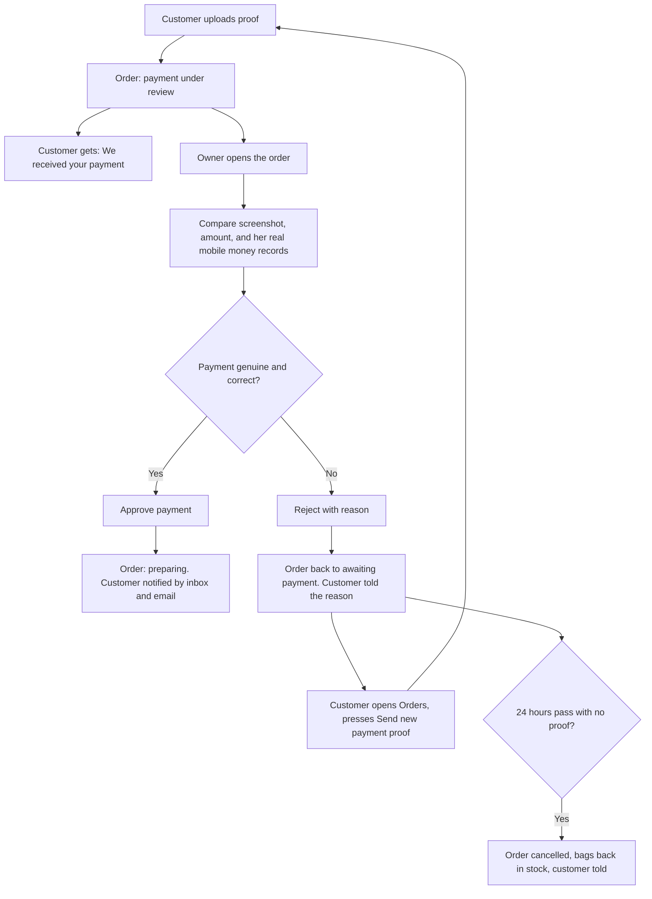
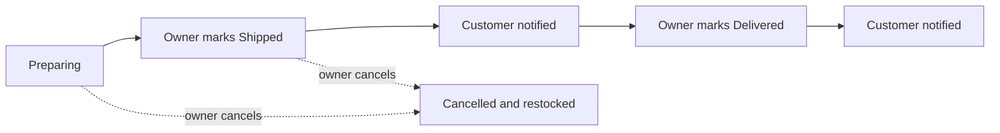
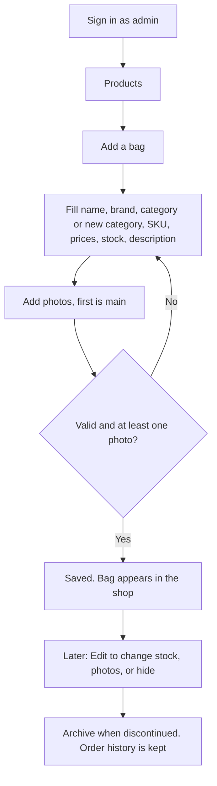
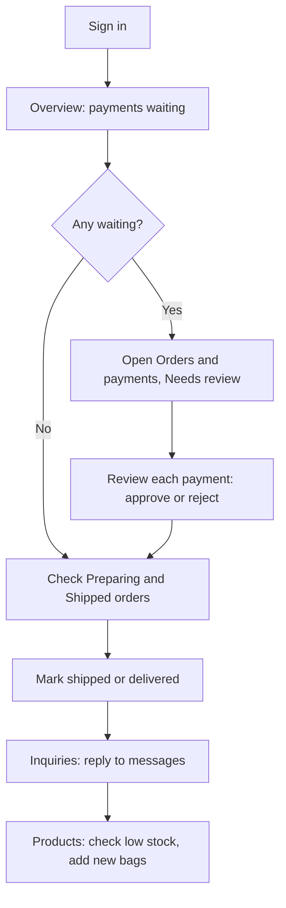
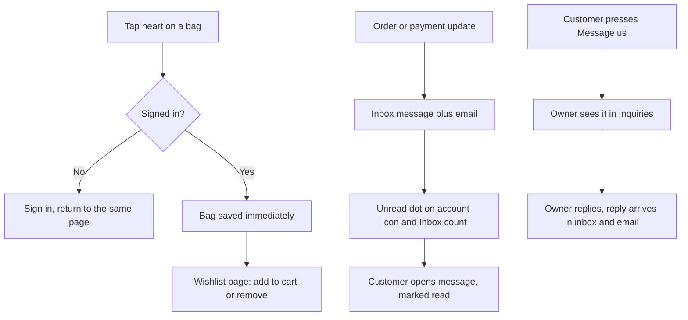

# User Flows

**Product:** Bryans Arabella Collection
**Version:** 1.0, October 2026

The diagrams use Mermaid. They display automatically on GitHub and in most Markdown viewers.

## 1. Shopper: from landing to placed order

## 2. Registration and email confirmation

If the owner turns on "require email confirmation", checkout shows a clear message until the email is confirmed.

## 3. Forgot password

## 4. Payment: review, rejection, and retry

## 5. After approval: fulfilment

## 6. Owner: add a bag

## 7. Owner: a normal day

## 8. Wishlist and inbox

## 9. Access rules
| Visitor | Can do | Cannot do |
|---|---|---|
| Not signed in | Browse, search, view bags and reviews, use the cart, read Help | Check out, review, wishlist, inbox, account |
| Customer | Everything above, plus check out, pay, review, wishlist, inbox, account | Open any admin page or admin data |
| Admin | Everything in admin, and the customer features | See other people's passwords; payment screenshots are visible to admins only |

## 10. Edge cases the flows handle
| Situation | What happens |
|---|---|
| Two customers want the last bag | The first order wins; the second sees "Only N left" |
| Customer reloads after the order is created but the upload failed | The order stays unpaid; they use **Submit payment proof** on the Orders page |
| Customer pays the wrong amount | Owner rejects with "Incorrect amount"; the customer is told and can resend |
| Customer never pays | The order expires after 24 hours and stock returns |
| Signed in for 30 days | The sign-in expires and the person signs in again |
| Email link used twice or too late | A clear message and a way to ask for a new link |
| Server unreachable | "We could not reach the server" with a Try again button |
